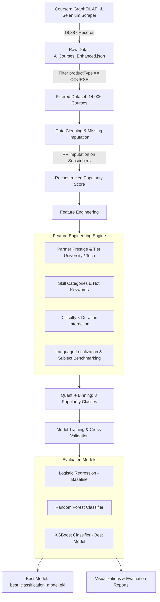

# A Data-Driven Analysis of Drivers Behind Coursera Course Popularity


---

## Project Overview

With the rapid expansion of Massive Open Online Courses (MOOCs), understanding what drives learner engagement and course popularity is critical for course creators, universities, and educational platforms.

This project delivers an end-to-end data analytics and predictive modeling workflow on **Coursera's ecosystem**:
1. **Large-Scale Data Collection**: Scraped and compiled a comprehensive dataset of **18,387 Coursera offerings** and **14,006 individual courses** combining high-throughput **GraphQL API** harvesting with targeted **Selenium** scraping.
2. **Methodological Rigor**: Handled missing subscriber data via **Random Forest Imputation**, formulated a balanced **Composite Popularity Metric**, and created a 3-tier balanced popularity classification target (`Low`, `Medium`, `High`) using quantile binning.
3. **Domain-Specific Feature Engineering**: Extracted over 80 multidimensional features, spanning institution prestige (Ivy League, top universities, Big Tech companies), trending technical skills, title semantics, course duration/difficulty interactions, and localization.
4. **Predictive Modeling & Insights**: Trained and evaluated multiple classifiers (**Logistic Regression**, **Random Forest**, and **XGBoost**) using stratified 8-1-1 splits and 5-fold cross-validation with strict data-leakage prevention.

---

## Architecture & Pipeline



---

## Key Methodology & Innovations

### 1. Composite Popularity Metric
To avoid single-metric bias (such as raw subscriber count being dominated by historical legacy courses), we defined a standardized composite popularity index:

$$\text{Popularity Score} = 0.5 \times \text{Subscribers}_{\text{norm}} + 0.3 \times \text{RatingsCount}_{\text{norm}} + 0.2 \times \text{AdjustedRating}_{\text{norm}}$$

To prevent extreme skewness and zero-inflation, quantile discretization (3 quantiles) was applied to categorize courses into **Low (0)**, **Medium (1)**, and **High (2)** popularity tiers.

### 2. Random Forest Missing Target Reconstruction
Raw enrollment data often presents missing values for unlisted or newly published courses. Rather than naive row deletion (which introduces severe survivor bias), we utilized a Random Forest Regressor trained on observed logarithmic rating volumes and Bayesian adjusted ratings to impute the unobserved log-subscribers with high precision ($R^2$ validation).

### 3. Leakage-Free Feature Engineering
All features directly correlated with target computation (e.g., raw ratings count, subscriber logs, normalized score components) were strictly excluded from model feature sets to ensure legitimate generalization.

---

## Dataset Structure

The curated datasets are stored under [`code/data/`](code/data/):

| Dataset File | Records | Features | Description |
| :--- | :--- | :--- | :--- |
| `AllCourses_Enhanced.json` | 18,387 | 14 | Initial dataset containing all product types (Courses, Specializations, Professional Certificates). |
| `Courses_Only_Dataset.json` | 14,006 | 57 | Filtered subset containing exclusively standalone courses with clean baseline attributes. |
| `Courses_Engineered_Features.json` | 14,006 | 80 | Full dataset enriched with partner, skill, interaction, and relative domain features. |
| `Courses_Final_Model_Ready.json` | 14,006 | 52 | Pre-processed, leakage-free numeric matrix ready for classifier training. |

---

## Quick Start

### 1. Environment Setup

Clone this repository and install dependencies:

```bash
git clone https://github.com/<your-username>/<your-repo-name>.git
cd DALAS_Project_Cousera_submission

# Navigate to code directory and install requirements
cd code
pip install -r requirements.txt
```

### 2. Run Model Training & Evaluation

To reproduce the multi-model comparison, 5-fold cross validation, and test evaluation:

```bash
python src/modeling/run_classification_training.py
```

* **Outputs**:
  - `best_classification_model.pkl`: Serialized best-performing model.
  - `model_evaluation_report.txt`: Full classification metrics (Precision, Recall, F1-score, Macro F1).
  - `模型训练图片结果/confusion_matrix.png`: Evaluation confusion matrix heatmap.

### 3. Generate Visualizations

To recreate exploratory data analysis charts and statistical distributions:

```bash
python src/visualization/create_visualizations.py
```

### 4. Re-run Feature Engineering (Optional)

If you wish to re-generate engineered features from the raw course dataset:

```bash
python src/data_processing/run_feature_engineering.py
```

---

## Repository Structure

```text
.
├── README.md                                                            # Repository Master Documentation
└── code/
    ├── requirements.txt                                                 # Python dependency list
    ├── README.md                                                        # Code directory execution guide
    ├── best_classification_model.pkl                                    # Pre-trained optimal model
    ├── data/
    │   ├── README.md                                                    # Data specification notes
    │   ├── AllCourses_Enhanced.json                                     # Scraped full product dataset
    │   ├── Courses_Only_Dataset.json                                    # Filtered courses dataset
    │   ├── Courses_Engineered_Features.json                             # Dataset with engineered features
    │   └── Courses_Final_Model_Ready.json                               # Model-ready numeric dataset
    └── src/
        ├── analysis/                                                    # Statistical check & readiness scripts
        │   ├── analyze_data_for_report.py
        │   └── analyze_model_readiness.py
        ├── data_collection/                                             # Scrapers (GraphQL, Selenium, Playwright)
        │   ├── coursera_graphql_scraper.py
        │   ├── coursera_full_scraper.py
        │   ├── coursera_batch_scraper.py
        │   ├── incremental_scraper.py
        │   ├── scrape_subjects.py
        │   └── coursera_playwright_scraper.py
        ├── data_processing/                                             # Cleaning & Feature Engineering scripts
        │   ├── filter_courses_only.py
        │   ├── prepare_classification_data.py
        │   ├── prepare_model_data.py
        │   ├── run_feature_engineering.py
        │   ├── run_advanced_feature_engineering.py
        │   └── ... (additional modular processors)
        ├── modeling/                                                    # ML Training & evaluation
        │   └── run_classification_training.py
        └── visualization/                                               # Figure generation
            └── create_visualizations.py
```

---

## Major Findings & Practical Takeaways

1. **Partner Brand Premium**: Courses affiliated with top global universities and marquee tech companies (Google, IBM, DeepLearning.AI) exhibit significantly higher probability of entering the top popularity tier.
2. **Practical Tech Skill Alignment**: Inclusion of high-demand industry skills (e.g., Python, SQL, Machine Learning) strongly increases enrollment rates compared to theoretical course designs.
3. **Difficulty & Time-to-Complete Balance**: Beginner-level, modular courses with flexible commitment windows attract the broadest audience, whereas advanced courses require strong brand reinforcement to achieve equivalent engagement.


---

## License

This project is licensed under the [MIT License](LICENSE) - see the LICENSE file for details.
